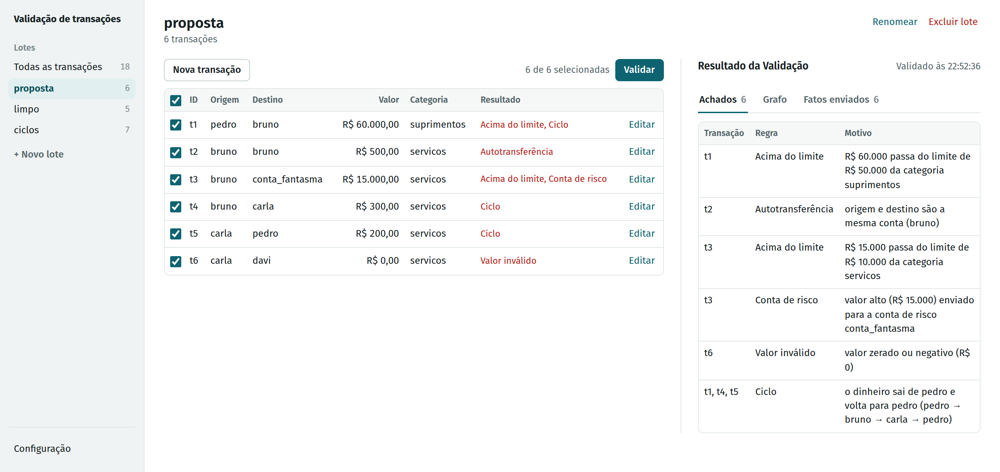
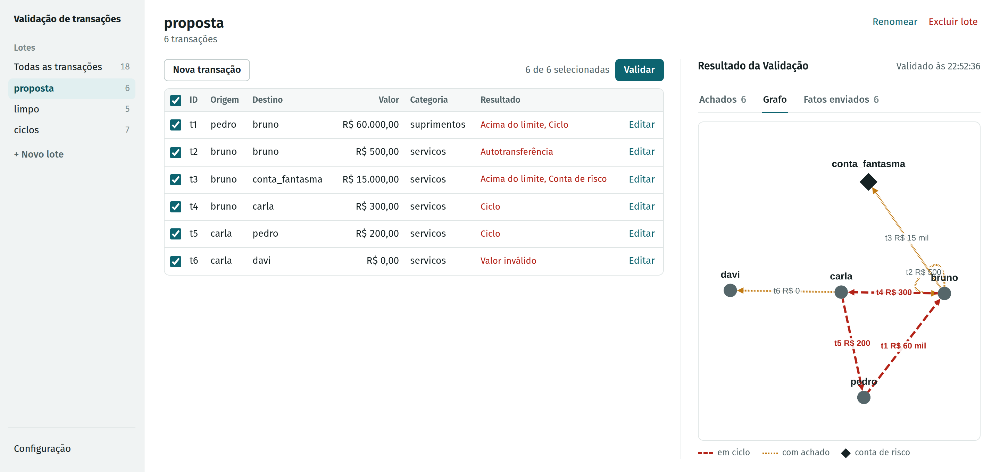
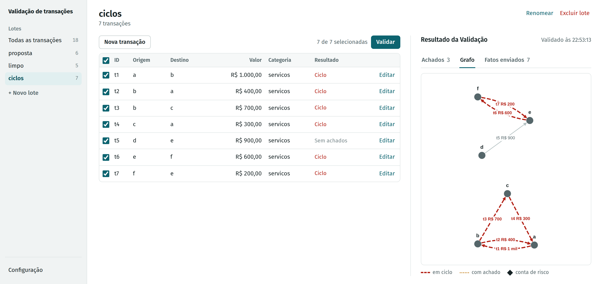
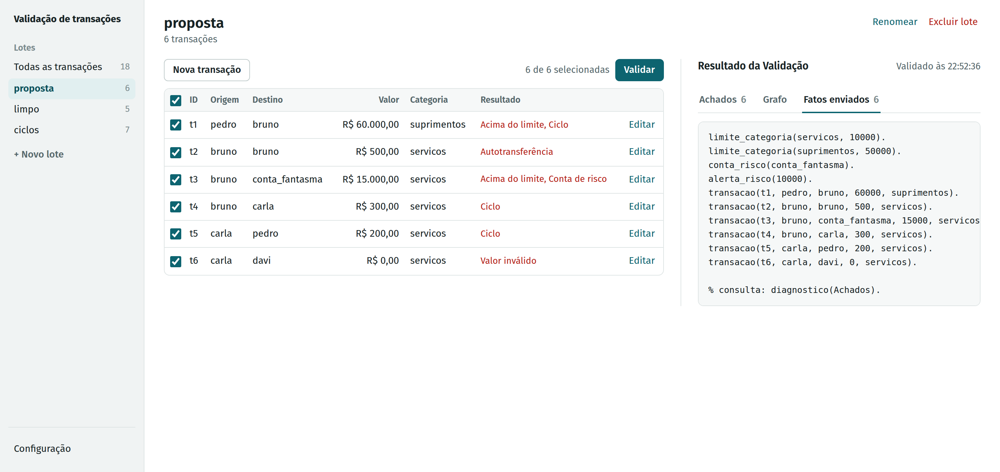
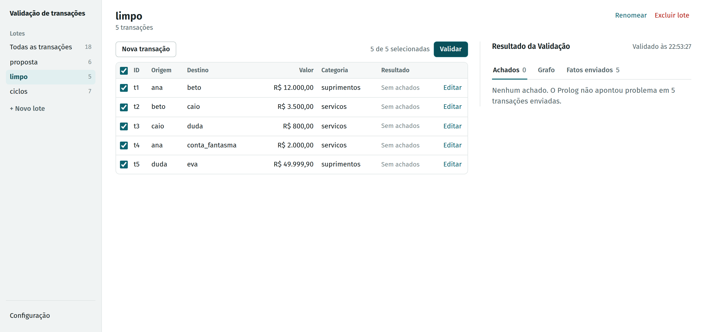
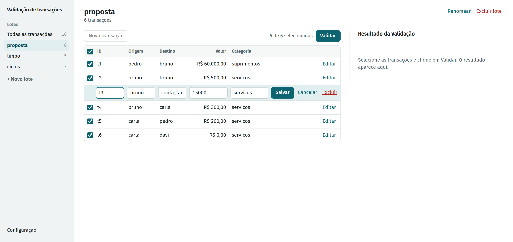
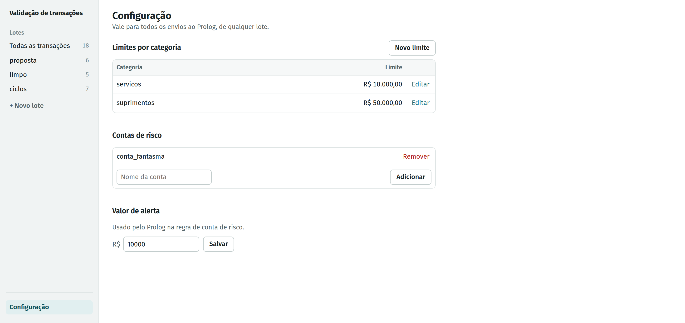
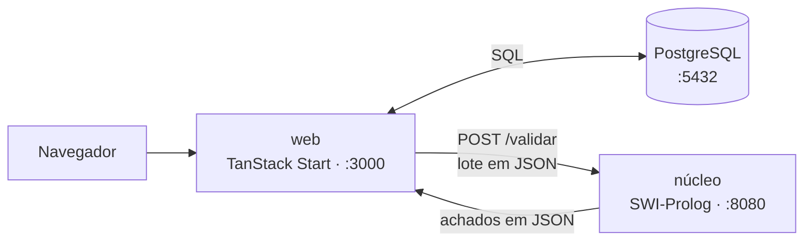

<div align="center">

# prolog-transaction-validator

Um auditor de transações financeiras com o motor de regras escrito em Prolog puro e uma
aplicação web completa para cadastrar lotes, validar e ver o caminho do dinheiro em um grafo.


</div>



## Em resumo

- **As regras de negócio cabem em um arquivo de ~120 linhas.** Quatro tipos de violação e a
  detecção de ciclos de dinheiro estão em [`nucleo/regras.pl`](nucleo/regras.pl), escritos como
  descrições do problema, sem laços nem estruturas de controle.
- **Detecta lavagem em círculo** (A → B → C → A) usando só recursão e backtracking, sem
  implementar busca em grafo na mão.
- **Cada achado vem explicado** em português: "R$ 60.000 passa do limite de R$ 50.000 da
  categoria suprimentos".
- **Nada fica escondido.** A aba *Fatos enviados* mostra exatamente os fatos que o Prolog recebeu,
  prontos para colar no `swipl`.
- **50 testes automatizados**, incluindo um de desempenho.
- **Sobe com um comando**: `docker compose up --build`.

## Como executar

Com o Docker instalado, na pasta do projeto:

```sh
docker compose up --build
```

Abra **http://localhost:3000**. O banco já vem com três lotes de exemplo: `proposta` (um caso de
cada regra), `limpo` (nenhum problema) e `ciclos` (vários ciclos, alguns sobrepostos).

| Serviço | Porta |
|---|---|
| Aplicação web | 3000 |
| Núcleo Prolog | 8080 |
| PostgreSQL | 5432 |

Para parar, `docker compose down`. Para voltar aos dados de exemplo, `docker compose down -v`
(apaga o volume do banco).

## Telas

<table>
  <tr>
    <td width="50%">
      
      <p><b>Grafo das ligações.</b> Cada conta é um nó e cada transação é uma seta. Vermelho
      tracejado marca ciclos, laranja pontilhado marca outros achados e o losango marca contas de risco.</p>
    </td>
    <td width="50%">
      
      <p><b>Ciclos sobrepostos.</b> No lote <code>ciclos</code>, o Prolog acha a → b → a,
      a → b → c → a e e → f → e. A <code>t5</code> (d → e) chega em um ciclo, mas não faz parte
      dele, e continua limpa.</p>
    </td>
  </tr>
  <tr>
    <td width="50%">
      
      <p><b>Fatos enviados.</b> A base de conhecimento exata daquela validação, junto com a
      consulta executada. A web não interpreta nada: só monta os fatos e mostra a resposta.</p>
    </td>
    <td width="50%">
      
      <p><b>Sem falso positivo.</b> O lote <code>limpo</code> fica perto dos limites sem passar
      deles: a <code>t5</code> está R$ 0,10 abaixo do teto e a <code>t4</code> vai para a conta de
      risco abaixo do valor de alerta.</p>
    </td>
  </tr>
  <tr>
    <td width="50%">
      
      <p><b>Edição na própria tabela.</b> Transações e lotes são criados, editados e excluídos
      pela tela, e as caixas de seleção escolhem o que entra em cada validação.</p>
    </td>
    <td width="50%">
      
      <p><b>Configuração.</b> Limites por categoria, contas de risco e valor de alerta ficam no
      PostgreSQL e entram como fatos em toda validação. Mudar uma política não exige mexer no código.</p>
    </td>
  </tr>
</table>

## Como funciona

### A ideia

Em uma linguagem imperativa, achar transferências de uma conta para ela mesma é um laço com um `if`:

```js
for (const t of transacoes)
  if (t.origem === t.destino) achados.push(t.id)
```

Em Prolog, você diz como uma autotransferência se parece e deixa o motor procurar:

```prolog
violacao(Id, autotransferencia, Motivo) :-
    transacao(Id, Conta, Conta, _, _),
    format(atom(Motivo), 'origem e destino são a mesma conta (~w)', [Conta]).
```

Repetir a variável `Conta` na origem e no destino já exige que as duas sejam iguais. Isso é
**unificação**. Não existe laço: o Prolog percorre todos os fatos `transacao/5` e devolve cada um
que se encaixa no padrão. O validador inteiro segue essa lógica. As transações viram **fatos**, as
políticas viram **regras** e a pergunta "o que está errado neste lote?" vira uma **consulta**.

### O que ele detecta

| Regra | Quando dispara | Exemplo no lote `proposta` |
|---|---|---|
| **Acima do limite** | o valor passa do teto da categoria | `t1`: R$ 60.000 em *suprimentos*, limite de R$ 50.000 |
| **Conta de risco** | um valor acima do alerta vai para uma conta marcada | `t3`: R$ 15.000 para `conta_fantasma` |
| **Autotransferência** | origem e destino são a mesma conta | `t2`: bruno → bruno |
| **Valor inválido** | valor zero ou negativo | `t6`: R$ 0,00 |
| **Ciclo** | o dinheiro sai de uma conta e volta para ela | `t1`, `t4`, `t5`: pedro → bruno → carla → pedro |

Uma mesma transação pode quebrar mais de uma regra (a `t3` quebra duas). O `findall/3` coleta
todas as soluções, então nenhum achado se perde.

### Ciclos de dinheiro

Dinheiro que sai de uma conta, passa por intermediárias e volta para a origem é um padrão clássico
de lavagem. Encontrar isso costuma exigir uma busca em profundidade com pilha e conjunto de
visitados. Em Prolog são duas cláusulas:

```prolog
caminho(Atual, Inicio, _, [Inicio]) :-
    aresta(Atual, Inicio).
caminho(Atual, Inicio, Visitados, [Prox|Resto]) :-
    aresta(Atual, Prox),
    \+ memberchk(Prox, Visitados),
    caminho(Prox, Inicio, [Prox|Visitados], Resto).
```

Lendo em voz alta: *existe caminho de volta ao início se há uma transferência direta para ele, ou
se há uma transferência para uma conta ainda não visitada a partir da qual existe caminho de volta*.
O backtracking testa cada saída possível sozinho. Como cada ciclo só é procurado a partir da
primeira conta dele que aparece no lote, ele sai **uma única vez**, sem deduplicação depois.

### Arquitetura



1. A web lê do PostgreSQL as transações selecionadas e a configuração.
2. Tudo vai em um único JSON para o núcleo Prolog.
3. [`servidor.pl`](nucleo/servidor.pl) valida a entrada (campos obrigatórios, tipos, IDs repetidos)
   e a converte em fatos: `transacao/5`, `limite_categoria/2`, `conta_risco/1`, `alerta_risco/1`.
4. [`regras.pl`](nucleo/regras.pl) carrega os fatos com `assertz`, roda `diagnostico/1` e limpa a
   base. O `with_mutex` impede que dois lotes se misturem em requisições simultâneas, e o
   `setup_call_cleanup` garante a limpeza mesmo se algo falhar.
5. Os achados voltam como JSON, cada um com a regra, as transações envolvidas e o motivo.

## Usando o núcleo sem a interface

O núcleo não depende da web. Por HTTP:

```sh
curl -s -X POST http://localhost:8080/validar \
  -H 'Content-Type: application/json' \
  -d '{"limites": [], "contas_risco": [], "alerta_risco": 0,
       "transacoes": [
         {"id": "t1", "origem": "a", "destino": "b", "valor": 5, "categoria": "x"},
         {"id": "t2", "origem": "b", "destino": "a", "valor": 5, "categoria": "x"}]}'
```

```json
{"achados": [{"regra": "ciclo", "contas": ["a", "b", "a"], "transacoes": ["t1", "t2"],
              "motivo": "o dinheiro sai de a e volta para a (a → b → a)"}]}
```

Ou direto no SWI-Prolog, carregando as regras e um arquivo de fatos:

```sh
docker compose exec nucleo swipl -g mostrar_diagnostico -t halt regras.pl lotes/seed.pl
```

```text
t1 [limite_categoria] R$ 60.000 passa do limite de R$ 50.000 da categoria suprimentos
t2 [autotransferencia] origem e destino são a mesma conta (bruno)
t3 [limite_categoria] R$ 15.000 passa do limite de R$ 10.000 da categoria servicos
t3 [conta_risco] valor alto (R$ 15.000) enviado para a conta de risco conta_fantasma
t6 [valor_invalido] valor zerado ou negativo (R$ 0)
t1,t4,t5 [ciclo] o dinheiro sai de pedro e volta para pedro (pedro → bruno → carla → pedro)
```

Com o SWI-Prolog instalado na máquina, o mesmo comando funciona sem o Docker, de dentro de `nucleo/`.

## Testes

```sh
docker compose exec nucleo swipl -g run_tests -t halt testes.pl
```

São 50 testes com `plunit`, em cinco grupos:

| Grupo | O que cobre |
|---|---|
| `base` | formatação em reais, lote vazio e limpeza da base depois de cada validação |
| `regras` | cada violação, casos de fronteira (valor igual ao limite não dispara) e lotes isolados |
| `ciclos` | ciclos simples, sobrepostos, sem duplicatas e transações que não fecham ciclo |
| `entrada` | JSON inválido, campos ausentes, tipos errados e IDs repetidos |
| `desempenho` | 100 transações aleatórias entre 60 contas validadas em menos de 1 s de CPU |

## Aprendendo Prolog com o projeto

A pasta [`exemplos/`](exemplos) tem cinco arquivos curtos que constroem, passo a passo, as ideias
usadas no validador:

| Arquivo | Conceito | Experimente |
|---|---|---|
| `01_fatos_consultas.pl` | fatos e consultas | `?- transferencia(bruno, X, V).` |
| `02_regras_inferencia.pl` | regras e inferência | `?- alerta(X).` |
| `03_unificacao_relacoes.pl` | unificação | `?- autotransferencia(X).` |
| `04_backtracking.pl` | backtracking | `?- transferencia(X, Y, V).` e `;` para a próxima |
| `05_recursao_caminhos.pl` | recursão e caminhos | `?- alcanca(pedro, X).` |

Para abrir um deles: `swipl exemplos/02_regras_inferencia.pl`.

Os slides da apresentação estão em [`slides/slides.pdf`](slides/slides.pdf).

## Estrutura e tecnologias

```text
nucleo/       motor em SWI-Prolog 9.2
  regras.pl     as regras de validação e a detecção de ciclos
  servidor.pl   servidor HTTP (library(http)) e conversão JSON → fatos
  testes.pl     50 testes com plunit
  lotes/        lotes de exemplo como arquivos de fatos
web/          TanStack Start + React 19 + TanStack Query, grafo com Cytoscape.js
db/           schema e dados iniciais do PostgreSQL 17
exemplos/     arquivos didáticos de Prolog
slides/       apresentação em LaTeX (Beamer) e PDF
```

Os três serviços (web, núcleo e banco) sobem juntos pelo `docker-compose.yml`.

## Autores

Grupo 3 da disciplina de Linguagens de Programação:

- Thiago Martins
- Carlos Arthur Moraes de Freitas
- Gabriel Marconato Momesso
